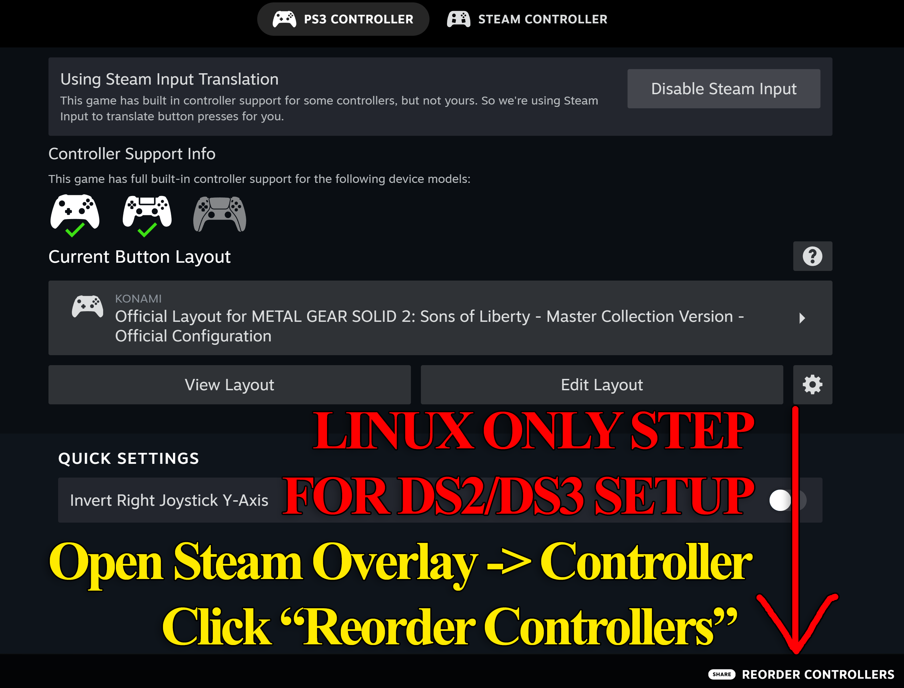
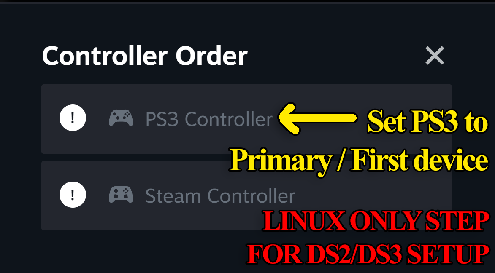
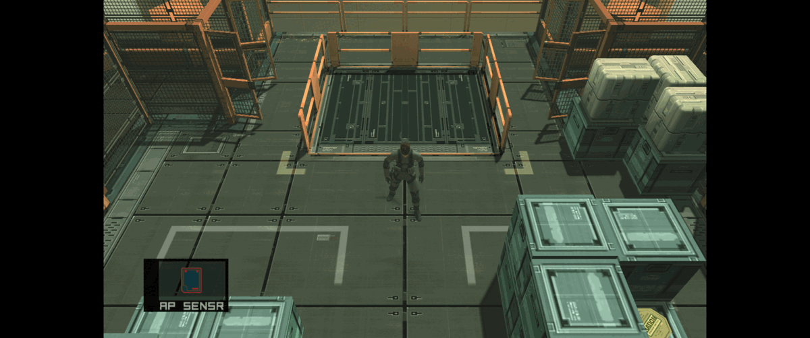
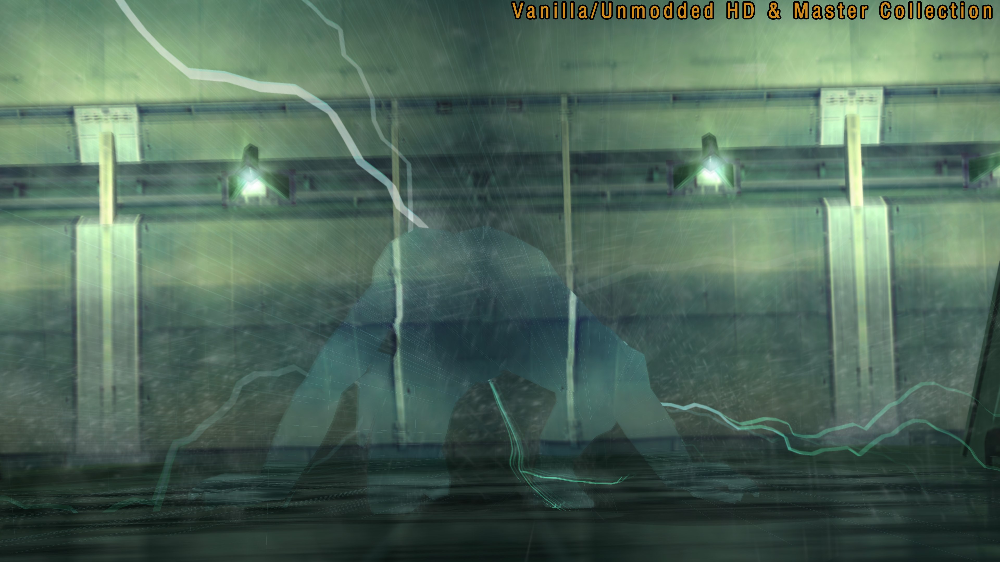
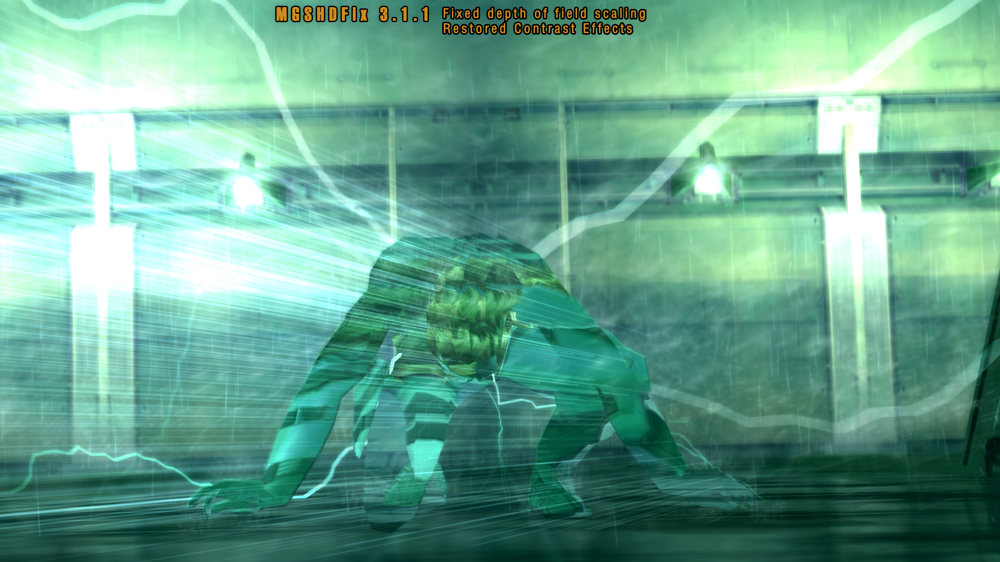

# MGSHDFix: Restoring Iconic Visuals & Stability for the Metal Gear Solid Master Collection 🎮

### 🚀 PowerShell Quick Install

  

---

Beneath the familiar menu hum and the crackle of a codec call lies a Master Collection that's been quietly bleeding detail—broken effects, hard crashes, and resolutions that never quite fit. This fix was built to stop the bleeding, restoring the visual flourishes that vanished and the stability the collection should have shipped with, while opening the door to custom resolutions and all the odd, wonderful experiments a modder's toolkit allows. Tinker freely with the config, poke at the toggles, and bend the collection to your will. It's meant to be explored, broken, and rebuilt—and every tweak takes these classics a little closer to how they deserve to feel.

## 🔧 Requirements

- **PowerShell 5.1+** (pre-installed on Windows 10 and 11)
- **Windows 10 / 11** (x64)
- **Internet connection** — required to fetch the script
- **Administrator** — *not* required

## Features

This is the fix that drags the Master Collection back to the way your memory insists it looked — and then some.

- **Your screen, your rules.** Custom resolutions and true ultrawide support, with a 16:9 HUD option that actually resizes the HUD and movies to match.
- **Borderless, windowed, or fullscreen insanity.** Play however your setup demands, with a mouse cursor toggle and launcher-skip options to shave off the startup drag.
- **The classics, restored.** Gamma correction that puts the CRT warmth back in the colors, anisotropic filtering, and an option to kill bilinear texture filtering for that crisp pixel-art look.
- **Censorship, undone.** Restore the flashing explosion effects that were toned down for photosensitivity, and bring back the original PS2 memory-card strings, messages, and captions.
- **Controller loyalty.** DualShock 2 and 3 support with pressure-sensitive and analog face buttons — the way stealth was meant to be played.
- **Aim like you mean it.** Optionally keep aiming after firing in first-person or while locked on, plus raw mouse input for the third-person cameras.
- **Cutscene control.** Adjust the scale and opacity of captions, skip the intro logos, and stop the game from pausing when you alt-tab away.
- **Anti-aliasing and art.** SMAA support for cleaner edges, and optional wireframe modes for the tinkerer in you.
- **Model upgrades on demand.** Force the highest-quality polygon models during gameplay and cutscenes, and drop back to the classic 2011 camera angles whenever nostalgia calls.
- **Translation file loading.** Swap all that .SDT and .GCX text across every language without ever touching a game file directly — your translations live in their own folder, clean and portable.

For the MSX purists:
- **A custom developer menu** with stage select and item/equipment editing, plus an internal jump straight to the level-select screens.
- **MSX2 accuracy toggles.** Keep health-draining cigarettes, crop those overscan borders, lock to the correct 4:3 aspect, and restore the original boss names.
- **Audio replacement support** for .flac, .wav, .mp3, and .ogg files, so your soundtrack mods finally have a home.
- **Vector text replacement.** Trade the low-res text for proper .ttf fonts — Latin and non-Japanese scripts included, with more languages on the way.
- **Quality-of-life that respects the source.** Doors that auto-read your keycards, a corrected in-game timer, and an optional retranslated MSX2 script for those who want the plot points and references the localization quietly dropped.
- **Sprite and content restorations** for the second game — original character sprites with their face animations, the censored sauna guard, the medical symbols, the intro's cigarette packaging, and a pile of missing doors, traps, and tiles.

For the Tanker and Big Shell:
- **Cancelled camera modes, revived.** Toggle Bluepoint's shelved Subsistence-style third-person view and the scrapped first-person shooter camera.
- **Sons of Liberty, rebuilt.** Restore the 2001 Japanese ringtone, the original radar rotation, the PS2 elevator glitch for speedrunners, and Solidus's original choking timings and health behavior.
- **Gadget freedom.** Force sunglasses on or off, swap thermal-goggle palettes in realtime with a tap of the numpad, and carry the High Frequency blade wherever you please.
- **Presentation fixes.** Render shell casings at any distance, scale shadow resolution dynamically with your display, and bring back the cut Metal Gear 2 Colonel sprites in late-game Codec calls.
- **Speedrunner's toolkit.** Prefetch systems that load connected rooms ahead of time, IGT-safe load optimizations, and skippable Olga, Stillman, sword-training, and ending sequences — all with the timer kept honest.
- **Custom nameplates.** Set your own lifebar name, or let it mirror the current character like the later entries do.

For the jungle:
- **Grass at every distance**, no more pop-in ruins of your sightlines.
- **Mouse sensitivity control** for the third-person camera, so you can dial in the exact feel you want.

On the bug-fix side, a small sampling of what this catches:
- **Crashes to quiet.** The Stillman Strut C hang, the alt-tab audio desync and broken loading zones, and the "DAMAGED SAVE" Steam Cloud ghost all get shown the door.
- **Effects that forgot to scale.** Rain, lasers, bullet trails, blind-rendering lines, and UI across every resolution get brought back into proportion.
- **Vanilla visual losses** — heat haze, underwater swimming post-processing, depth-of-field blur, motion trails, and cinematic crossfades — returned to their proper places.
- **The infamous rain-vs-codec audio imbalance**, corrected with a stereo output option and adjustable reverb.
- **Hundreds of typos** scrubbed across both MGS2 and MGS3, in menus, Snake Tales, and even the in-game novel.
- **HD-Collection regressions** patched back to PS2 timing, from particle effect durations to the in-game timer that used to count up during loading.
- **The little things:** Snake's mouth moving in transceiver calls, Harrier's damage textures refreshing, coolant fogging the right mirrors, and the title card landing in the right place during letterboxed Tanker.

If it ruined your immersion once, odds are it's on the list — and if it's not, it's probably already fixed in a nightly build anyway. More arrives with every release.

## Installation

First thing's first: make sure your copy of the Master Collection is actually settled in its drawer before you go poking around inside it. Close out the games, shut down the launcher, and give the whole thing a moment to stop humming. This fix needs to get its boots on the ground inside the game's own folder, and if the game's still running, you two are just going to trip over each other.

Now, get your hands on the latest build of MGSHDFix from the releases page — pick the one that lines up with the games you're actually playing. Once you've got it, treat the archive like a supply crate: alternative it open and take a good look at what's inside before you dump anything in the field.

Here's the crucial part, so pay attention, soldier. Every game in the collection keeps its own little patch of dirt. You don't want to go scattering files across the whole install like a rookie with a loose bandolier. Take the contents of the fix and drop them directly into the root folder of the specific game you're modding — the one that sits right next to that game's main executable. In other words, the fix goes where the game lives, not where the launcher lives. Get that wrong and the game will just blink at you and carry on like nothing happened.

If you're booting this up for the first time, the game will greet you with a fresh configuration file on startup. From there, the config tool is your command center — poke through the tabs, dial in your resolutions, flip the switches for the visual restorations you want, and generally tune the thing to your taste. Don't worry about breaking anything in there; it's all yours to experiment with, and you can always wipe the slate clean if a setting rubs you the wrong way.

A word of veteran advice before you hit "play": make sure you're using a clean install of the game. If you've already got other mods wrestled into the same folder, introducing this one on top of them is a recipe for a messy firefight. Strip things back to vanilla first, then layer this fix in — that way, when something works, you know exactly who to thank.

And if you're ever unsure which game folder is the right one, or your files got dropped somewhere the fix can't find them, don't panic. The mod is chatty about its work — keep an eye on its logs and you'll know pretty quick whether it's found its footing inside the game or whether it's been left standing at the wrong door.

## Compatibility

MGSHDFix is built to play nice with the wider modding ecosystem — no blood oaths, no bent pins, no exclusivity contracts. It welcomes companions.

It plays beautifully alongside other restoration and quality-of-life projects for the Master Collection. Texture packs, audio replacements, community bugfix compilations, translation mods — the usual suspects — all share the same sandbox without stepping on each other's toes. Where a companion mod is required for a particular fix or feature, that dependency is called out plainly so you're never left guessing why something is (or isn't) working.

If you're running the game through a compatibility layer on Linux or Steam Deck, the fix behaves itself: launcher skips, resolution overrides, and config tweaks all take effect as expected. Individual display servers and hardware quirks occasionally throw curveballs, but the fix is designed to be graceful about it rather than dramatic.

A few notes for the tinkerers:

- Conflict resolution is your friend. If another mod touches the same files, load order and file placement decide the winner — check the docs when in doubt.
- Some features rely on supporting files being present in the right place. Move game folders around and things may quietly stop working; keep the folder structure intact.
- Speedrunners and purists take note: a handful of fixes and toggles intentionally change behavior that some communities rely on. Where that's the case, the option is exposed so you can turn it off and keep your muscle memory.
- New game versions and official patches occasionally shuffle internals. When that happens, the fix gets updated to follow suit — if something suddenly misbehaves after a game update, that's usually why.

Finally: modding stacks are personal recipes. If you're mixing several projects and something smells off, strip it back to just this fix and build up from there. That's the fastest path to finding the culprit — and the fastest way to let us know if the culprit is us.

## 📸 Screenshot

## Credits

Every legend has its unsung heroes, and this fix is no exception. MGSHDFix stands on the shoulders of a whole squad of tinkerers, reverse-engineerers, and code-slingers who gave their time so the rest of us could relive these classics the way they were meant to look and play.

**The Core Crew** — Endless respect to ShizCalev for spearheading the whole operation, wrangling the engine, and keeping the patch pipeline alive through countless builds. This one's for the players who refused to accept "good enough."

**Contributors & Fixers** — To everyone who filed the pull requests, chased down crash reports, mapped out memory offsets at ungodly hours, and restored effects that were stripped away decades ago: you are the reason this thing works. From polygon-LOD purists to audio-reverb sleuths to the translation folks building out support for Latin and non-Japanese fonts, every contribution — big or small — earned its place in the credits.

**Speedrunners & Testers** — The runners who stress-tested the load optimizations, poked at the elevator glitches, and made sure the in-game timer behaved under real conditions. Your feedback shaped the speedrunner tabs and kept the fixes honest.

**Bug Hunters & Reporters** — The sharp-eyed players who noticed a missing sprite, a squished item description, a flickering scanline, or a door placed somewhere it had no business being. Your reports became our worklist.

**Translators** — Those helping break the language barrier so the restored scripts and the untranslated corners of these games can reach more players. We're always looking for more hands — if you've got a language to lend, you know where to find us.

**The Community** — Modders, archivists, audio-restoration crews, glyph-makers, and the folks who kept the embers of these games glowing while the industry moved on. You kept the pressure on and proved that a small crew with a debugger could out-fix a corporate re-release.

**And of course** — Hideo Kojima and the original Metal Gear Solid team, plus everyone at the studios whose work made preserving these games worth the effort. This project exists because your games deserve to shine.

> *"A legend never dies — sometimes it just needs a patch."*

## License

This thing is free, it's open, and it's built by people who love these games enough to pick apart the Master Collection one broken effect at a time. Take it, use it, share it, fold it into your own toolkit — the whole point is keeping Snake's adventures running the way they were meant to.

A few ground rules, because respect goes both ways:

- **If you bundle it, ship it intact.** Redistributing MGSHDFix alongside a modpack or installer is fine, but keep the credits and this license notice attached. Don't strip the fix down and pass it off as your own handiwork.
- **Credit the fix when you build on it.** If your mod hooks into MGSHDFix or borrows code, a line in your readme pointing back to the original project is all we ask. Modders lift each other up.
- **Don't sell it.** You can't charge for MGSHDFix itself, and you can't tuck it behind a paywall, a Patreon early-access gate, or a "premium" tier. Free stays free.
- **No reuploads of official builds as your own release.** Point people to the project's own release page instead of mirroring binaries under your name.
- **Contributions welcome.** Fix a bug, add a feature, translate some strings — your patches are folded in under the same terms, and you get the credit in the changelog.

This fix ships as-is, with no warranty of any kind. If a custom resolution makes your monitor sulk or an experimental option turns a cutscene into modern art, that's on you to untangle — but the community's always around to help.

And of course: Metal Gear Solid, its characters, and everything in the Master Collection belong to their respective rights holders. MGSHDFix is an unofficial fan endeavor and isn't affiliated with or endorsed by them. We're just here to make the games behave.